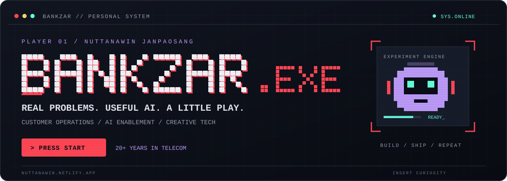

<p align="center">
  <a href="https://nuttanawin.netlify.app/">
    
  </a>
</p>

<p align="center">
  <a href="https://nuttanawin.netlify.app/"></a>
  <a href="https://github.com/bankzar?tab=repositories"></a>
</p>

# Hey, I'm Bank · Nuttanawin Janpaosang

**Customer Operations Leader · AI Builder · Creative Problem Solver**

ผมเอาปัญหาจากหน้างานจริง มาสร้างเป็นเครื่องมือที่คนใช้ได้จริง — ตั้งแต่ AI และระบบจัดทีม ไปจนถึงเว็บที่เปิดมาแล้วเล่นได้ 🎮

With **20+ years in Thailand's telecom industry**, I connect customer operations, workflow design, UX/UI, and practical AI adoption. I build for the people doing the work.

```text
bankzar@lab:~$ cat mission.txt

  REAL PROBLEMS  →  SMALL EXPERIMENTS  →  USEFUL TOOLS

  [01] Make AI useful in everyday operations.
  [02] Give teams better tools to plan and work.
  [03] Keep a little room for play.
```

## 🕹️ Select your mission

<table>
<tr>
<td width="50%" valign="top">

### 01 / NongBank Voice Studio

**AI VOICE · TH / EN**

A preset-driven expressive TTS studio powered by Google Gemini. Give Thai and English a little more character.

[Open the studio →](https://github.com/bankzar/NongBank-Voice-Studio)

</td>
<td width="50%" valign="top">

### 02 / NINJA SEAL LAB

**COMPUTER VISION · PLAY**

A webcam hand-seal game and a three-jutsu demo. An experiment at the intersection of interaction and imagination.

[Enter the lab →](https://github.com/bankzar/ninja-seal-lab)

</td>
</tr>
<tr>
<td width="50%" valign="top">

### 03 / Erlang C Dashboard

**WORKFORCE MANAGEMENT**

Staffing calculations and a WFM dashboard that bring contact-center planning into focus.

[Launch demo ↗](https://erlangc.netlify.app/) · [Source →](https://github.com/bankzar/erlangc)

</td>
<td width="50%" valign="top">

### 04 / Shift Schedule Planner

**OPERATIONS · PRODUCTIVITY**

Plan shifts with configurable staffing ratios, saved settings, and Excel export.

[Launch demo ↗](https://shift010269.netlify.app/) · [Source →](https://github.com/bankzar/shift-schedule-planner)

</td>
</tr>
</table>

## ⚡ My loadout

<p>
  
  
  
  
  
  
</p>

**Where I add value:** AI enablement · Customer operations · Workflow design · Workforce planning · UX/UI thinking

## 🏆 Achievement unlocked

Selected recognition from my [portfolio](https://nuttanawin.netlify.app/#projects):

| Year | Quest | Result |
| :--- | :--- | :--- |
| 2026 | Kaggle AI Lecture & Hackathon · Burapha University | 🥇 Winner · Flowchart-to-Code Alignment Verifier |
| 2026 | AIAT Time Series Hackathon | 🥉 2nd runner-up |
| 2026 | OpenAI × AIAT Hackathon | 🏅 Honorable mention |
| 2025 | AI BOOST UP · NECTEC × NSTDA | 🥇 Winner |
| 2025 | NT Agentic AI Hackathon | 🥈 1st runner-up |
| 2025 | NT KM Award | 🥇 Winner |

<details>
<summary><b>🗂️ More from the lab</b></summary>

- [BANKZAR.EXE — Playable AI Portfolio](https://nuttanawin.netlify.app/): a retro portfolio with 8-bit games, a CRT aesthetic, and contact unlocks.
- [Website repository](https://github.com/bankzar/website)
- [Explore all public projects](https://github.com/bankzar?tab=repositories)

</details>

---

<p align="center">
  <b>HAVE A REAL-WORLD PROBLEM? LET'S BUILD SOMETHING USEFUL.</b><br />
  <a href="https://nuttanawin.netlify.app/#contact">Connect through my portfolio ↗</a><br /><br />
  <sub>INSERT CURIOSITY. PRESS START. KEEP BUILDING.</sub>
</p>
